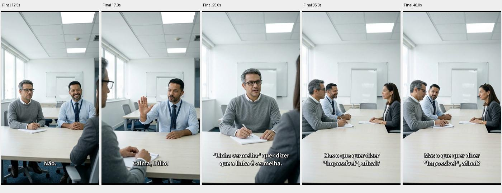

# Investigação do fluxo nativo e do resultado editorial

9 de novembro de 2026, America/Sao_Paulo. Projeto `br-viral-reuniao-impossivel`, sessão `7409a38e-b7b2-4177-9064-bbaae6585c9a`, timeline `tl-99ec13b6`. Investigação principal do prompt 1, feita na worktree `0372/ArcReelBR`. Código de referência `1df5ee3b89e865c4193e72d5bbddf64d54b42f0e`.

## Diagnóstico executivo

**O insumo foi realmente o principal gargalo? Não está comprovado.** O briefing inicial descrevia uma adaptação livre que não correspondia à fidelidade desejada, mas isso foi corrigido antes de qualquer mídia paga. O Agent leu a fonte textual completa e selecionou o trecho. O problema final não se explica por falta de acesso a toda a história nem por ausência geral de ferramentas no MCP.

As evidências mais fortes mostram uma combinação:

1. **Escolha e aprovação editorial do recorte:** o trecho termina numa pergunta que na fonte recebe uma resposta logo depois. Foram retiradas apresentações e a progressão posterior. O revisor já avisara que o resultado poderia parecer cortado, mas aceitou reação silenciosa como fechamento. Isso sustenta contribuição de estrutura/recorte, sem provar o efeito em todo público.
2. **Continuidade perdida nos keyframes e aceita na revisão:** Júlio e Marcos aparecem lado a lado em E1S02; o storyboard selecionado de E1S05 os coloca frente a frente. O vídeo preserva a contradição. O revisor detectou e a timeline registrou a aceitação. A primeira divergência residual está na imagem, antes da animação.
3. **Revisão audiovisual incompleta:** ninguém ouviu os clipes na rodada, segundo sua própria entrega. ASR local verificou texto e elegibilidade de tempos, não atuação, identidade vocal, sincronismo ou ritmo cômico. Quatro planos foram exportados com legenda mecânica, um com timing medido.
4. **Inspeção do roteiro insuficiente para a necessidade do usuário:** a entrega continha falas PT-BR e explicações em inglês, mas não a tradução inglesa integral das falas. Nesta auditoria ela foi preparada separadamente, preservando o roteiro produzido.

Fontes: [reconstrução com seq/timestamps](session-reconstruction.md), seções 1, 2, 4–7; `edit_timelines/episode_1/tl-99ec13b6.json`, revisão 2, motivo de c3; [comparação visual](visual-evidence/final-cut-comparison.jpg); [roteiro PT-BR/inglês e ASR](script-pt-en.md). A insatisfação do usuário vem do handoff, seção User feedback and acceptance state, e permanece distinta das avaliações nativas.

**Conclusão causal delimitada:** há evidência direta de erro espacial e de aceitação consciente desse erro. Há forte evidência de risco narrativo reconhecido e mantido. A importância relativa de briefing, escolha do trecho, atuação, edição e expectativas não foi isolada por experimento. Chamar o insumo de causa principal seria mais forte do que os dados permitem.

## Versão customizada e limites desta investigação

O worktree foi atualizado com `origin/main` antes desta etapa, por pedido explícito do usuário. O commit mais recente só atualiza documentos do handoff. O checkout que executa a aplicação é `/Users/pablo.carminatti.br/Projects/ArcReelBR`, também no mesmo SHA no início. Não foram feitos outros fetches, commits, pushes, mudanças de branch ou alterações na aplicação durante a auditoria. Os relatórios ficaram apenas nesta worktree e no diretório autorizado.

O backend respondeu `status=ok`, `commit=null`; frontend respondeu HTTP 200. O registro de reinício `docs/handoffs/2026-11-09-investigations/restart-verification.md:5-27` informa inicialização posterior às correções e 77 ferramentas anunciadas. Esse registro é histórico recente, não descoberta MCP refeita nesta investigação. HTTP saudável, sozinho, não identifica código carregado. Verificação final e hashes estão em [verification.json](verification.json).

Diferenças locais que afetam o método:

| Particularidade | Consequência para a investigação | Fonte |
|---|---|---|
| Produto RafaCena sobre framework ArcReelBR independente | Ler contratos locais primeiro; vitrine upstream não comprova comportamento personalizado | `frontend/src/branding.ts:1-29`; `docs/independent-maintenance.md:3-37` |
| ad sem produtos suporta curta geral | Não tratar ausência de produtos como erro; não exigir divisão de romance ou script_plan de drama | `agent_runtime_profile/CLAUDE.ad.md:75-85,135-141` |
| pt-BR explícito, separado de idioma da UI/resposta | Texto criativo permanece PT-BR; tradução inglesa é artefato de inspeção | ADR 0122; `lib/infra/content_language.py:7-27`; `lib/prompts/prompt_rules/content_language.py:6-16` |
| Agent principal e texto interno por assinatura têm montagens diferentes | Backend interno sem ferramentas não significa que o Agent perdeu skills/MCP/subagentes | `server/agent_runtime/options_assembler.py:377-410`; `lib/backends/text_backends/claude_subscription.py:149-179` |
| MCP local já expõe controles de sessão, configuração/referências/custos e edição | Auditar consumo e uso efetivos antes de recomendar ferramenta nova ou controlador externo | `server/session_mcp.py:100-210`; `server/media_tools/workflow_access.py:34-120,186-297` |
| Revisão de fala local conservadora já existe | Distinguir transcrição, aplicação de timing e qualidade audiovisual. Não propor reconhecimento como se estivesse ausente | `lib/speech/audio_review.py:36-84,104-169`; `server/media_tools/speech_review.py:25-95` |

O levantamento preliminar permanece em [preflight-project-state.md](preflight-project-state.md) e [preflight-customization-sources.md](preflight-customization-sources.md). Seus limites de preflight não descrevem as consultas adicionais agora realizadas. Integração H3 antecede o marco de manutenção independente, portanto não foi atribuída como novidade brasileira.

**Separação da auditoria de configuração:** este relatório identifica apenas o modo da produção, os requests registrados, as referências consumidas e o efeito sobre a história. Não audita todas as credenciais, overrides, catálogo, defaults globais, conta, assinatura ou preço atual. Achados de configuração devem ser reconciliados pela investigação paralela sem sobrescrever este diretório.

## Método e classes de evidência

- **Comprovado:** leitura do contrato proprietário, registro nativo ou artefato identificado; não implica causalidade universal.
- **Hipótese parcial:** mecanismo plausível e evidência favorável, com alternativas ainda abertas.
- **Não verificado/inacessível:** consulta não realizada ou ferramenta sem acesso; não preencher lacuna por suposição.
- **Recomendação editorial/operacional:** proposta, sem implementação, execução ou garantia.

Foram consultados AGENTS, glossary, arquitetura, ADRs de idioma, perfil nativo, skills e serviços; históricos SDK e subagentes; versões, checkpoints e apresentações; interface autenticada; docs oficiais online e fontes dos modelos. Os anexos citam arquivos/linhas, URLs/seções e seq/timestamp. A leitura de históricos utilizou SQLite exclusivamente em `mode=ro`, como alternativa documental; não retomou a sessão nem escreveu diretamente no banco/projeto. Isso é inspeção fora do MCP, não produção fora do framework.

Não havia ferramenta ArcReel conectada nesta conversa nem credencial reutilizável localizada na configuração MCP inspecionada. Não se criaram tokens nem se refez login. Por isso não houve novo `tools/list`, `get_workflow_plan` ou consulta MCP autenticada. Seus contratos e uso histórico são verificáveis pelo código e pela sessão. A UI autenticada foi observada na sessão existente do Chrome; o navegador isolado mostrou login. Cobertura e ações estão em [ui-observations.md](ui-observations.md).

FFprobe mediu mídia existente. FFmpeg apenas extraiu quadros para anexos, sem alterar ou renderizar a produção. Foram comparados keyframes e início/meio/fim dos clipes, incluindo versões rejeitadas relevantes, e quadros do final. **Não houve escuta nem reprodução audiovisual contínua validada.** O preview da timeline mostrou Unable to play media. A análise de fala usa evidência ASR preservada da rodada anterior; não houve nova inferência. Não se atesta atuação, humor na performance ou sincronismo labial com base em imagens.

## Fluxo nativo e cobertura das entradas

O inventário completo está em [workflow-inputs.md](workflow-inputs.md): casos de uso, passos reais, responsáveis, critérios de avanço, formatos, defaults, efeitos de ausência, persistência, consumidores, MCP e exemplos. A UI observada complementa o contrato, sem presumir que todos os campos foram exercitados.

| Caso | Suporte e percurso relevante |
|---|---|
| Série dramatizada | Drama: fonte completa ou episódios, planejamento/normalização, confirmação do conteúdo, autoria visual, assets, imagens ou referências diretas, vídeo, edição. |
| Roteiro pronto/minidrama por episódio | Drama com screenplay de episódio permite preservar falas e pular divisão integral; um episódio é possível. |
| Sketch/meme/curta livre | Ad sem produtos: briefing, roteiro formal direto sem confirmação universal de roteiro, assets, storyboards ou reference video, revisão, edição. Humor não é modo dedicado nem resultado garantido. |
| Anúncio | Ad com produtos e originais; requisitos de fidelidade comercial e soft gates próprios. Não impor a curta sem produto. |
| Narração/comentário | Texto narrado, segmentos/unidades, imagem/vídeo e entrega de narração escolhida; não confundir com diálogo diegético. |
| Adaptação automática de vídeo completo | Não foi comprovado importador que transforme YouTube em história validada. O Agent deve ler e transpor a fonte. reference_video é uma rota de geração, não sinônimo de reprodução do vídeo editorial. |

A ordem não é uma lista universal fixa: `get_workflow_plan` determina `next_action` a partir do estado e das dependências. Assets podem surgir antes ou depois da geração do roteiro. No teste, o caminho real foi ad/storyboard, com personagens e cinco shots. Faltas de produtos, episódio planejado ou TTS não representam etapas esquecidas desse curta. Fonte: `agent_runtime_profile/.claude/skills/video-workflow/SKILL.ad.md:13-24,52-59` e referência workflow-plan.

**Entrada tecnicamente suficiente não é briefing editorialmente adequado.** Ad permite gerar com brief ou produtos; isso não exige premissa, público ou desfecho em campos separados. Story setting efetivamente entra no ad/storyboard, mas pode ficar vazio e o brief fornecer o contexto. Arquivo em source não é automaticamente consumido pelo gerador ad; nesta produção foi lido pelo Agent, que adaptou o roteiro por ferramentas. `note` é persistido e excluído da geração. Fontes: inventário, seções de consumo e cadeia Story setting.

## Reconstrução: onde o conteúdo mudou

| Transição | Evidência | Implicação |
|---|---|---|
| Metadados/premissa → roteiro brasileiro original de 20 s | Sessão raiz:2,62 | Fidelidade desejada ainda não estava representada no pedido delegado inicial. |
| Revisão → piada de reuniões sobre reuniões | raiz:98,130,142,157 | Houve revisão, mas essa versão não virou vídeo. Não atribuir seu defeito ao render final. |
| Vídeo/legendas completos disponíveis → instrução de adaptação fiel | raiz:160,186,209,226 | Escopo corrigido; fonte textual completa comprovadamente lida antes dos custos. Inspeção audiovisual original contínua permanece não demonstrada. |
| Fonte completa → recorte 36.044–64.187 s | raiz:247 | O próprio Agent escolheu os cinco beats e excluiu contexto anterior e resposta seguinte. |
| Roteiro quatro planos/37 s → cinco planos/40 s | raiz:267,278,287; revisor a5ec:23,36 | Separação de locutores e fala mais longa; fechamento silencioso mantido apesar de risco explícito. |
| Fichas → keyframes | Bases em versions.json e checkpoints | Personagens e quadro anterior foram usados; não houve cenário próprio. E1S03 herdou E1S05 v1 rejeitado antes da correção. |
| E1S05 v1 → v2 | Arquivos de versões e revisão de imagens | Corrigiu quem ergue a mão/identidade focal; persistiu outra relação física de assentos. |
| Keyframe v2 → vídeo Marcos | Checkpoint i2v/start_image e quadros | Erro espacial já está na imagem; clipe o mantém. |
| Revisões → timeline integral e render | revisor ac9e:17; timeline rev.2; raiz:486 | Erro de assentos aceito, sem trims, com quatro timings mecânicos. Final 1080×1920 é upscale dos clipes 768×1344. |

O anexo [session-reconstruction.md](session-reconstruction.md) fornece subpath/seq/timestamp completos e mudanças aplicadas. As chamadas históricas externas são mensagens de Codex para o Agent, não transcrições literais de cada instrução humana. A escolha/obtenção inicial da fonte e seu transporte foram intervenções externas; roteiro, recorte, prompts, geração e edição foram do Agent integrado. Não alegar autonomia integral sem essa ressalva.

### Configuração estritamente relevante à cadeia

Os seis checkpoints de vídeo registram `execution_capability=i2v`, `execution_provider_id=minimax`, modelo `MiniMax-H3`, áudio true, resolução do request null, um único `start_image` e nenhum alvo de áudio de referência. O endpoint nativo define default 768p e codifica a imagem como `first_frame`. Durações pedidas 12/4/8/10/6 s; abertura foi gerada novamente uma vez. Isso não é reconstrução por defaults apenas: os arquivos confirmam 768×1344/24 fps. O render final mede 41,4 s, 1080×1920/30 fps. Fontes: [generation-evidence.json](generation-evidence.json), [media-probes.json](media-probes.json), `lib/custom_provider/builtin_endpoints/minimax-h3.json:12-18,24-50`; versão registrada em `lib/script/reference_video/execution_checkpoint.py:945-978`.

As bases de imagem registram fichas e anterior por hash; o código monta por listas de assets e condição sem segment_break antes de aplicar os limites do modelo. O checkpoint comprova mídia preparada e associada à chamada, não observação independente dos internals do fornecedor. Não foi encontrado envio do vídeo original ao gerador, nem arquivo vocal consumido. Fontes: [session-reference-evidence.json](session-reference-evidence.json); `lib/artifacts/generation_input.py:333-389,686-710`; inventário e anexo oficial.

O handoff registra USD 4,8463545 de mídia na rodada, compatível com o arredondamento de USD 4,85 visto na UI e na entrega. Trata-se de ledger da aplicação documentado anteriormente, não reconciliação independente de fatura ou medida de consumo da assinatura de texto. Esta investigação não gerou gasto novo nem reutiliza o teto histórico de USD 22.

## Continuidade espacial: diagnóstico independente

Tempos abaixo são globais, obtidos somando durações das apresentações/clipes sem trims. O final arredonda a fronteira total para 41,400 s; diferenças de centésimos não alteram a localização do defeito.

| Intervalo aproximado | Evidência visual e conclusão |
|---|---|
| 0–12,250 s, E1S01 | Regina sozinha, não estabelece a posição dos dois homens. Isso reduz orientação espacial, mas não comprova por si só troca de assento. |
| 12,250–16,708 s, E1S02 | Júlio à esquerda e Marcos à direita, lado a lado, Regina em primeiro plano oposto. Janela na lateral esquerda e quadro atrás dos homens. |
| **16,708–24,708 s, E1S05** | **Júlio em primeiro plano à esquerda e Marcos separado pela mesa, em frente.** A superfície/aresta da mesa e cadeiras deixam a relação física incompatível com a dupla lateral. Não é apenas inverter esquerda/direita num contraplano. |
| 24,708–34,833 s, E1S03 | Júlio em close com Regina parcialmente visível em frente. Não mostra sozinho onde Marcos está; não prova nova movimentação física de Júlio. |
| 34,833–41,400 s, E1S04 | Plano aberto restitui Júlio/Marcos lado a lado, Regina oposta. Evidência de segunda quebra no conjunto, sem ação que mostre deslocamento de cadeira. |

A discrepância do plano 3 existe no storyboard atual e nos frames a 0,10/4,00/7,85 s do clipe. Portanto **não é necessário culpar a animação H3 pelo nascimento desse erro**. A primeira versão do storyboard já invertera as posições e dera o gesto ao personagem errado; a regeneração corrigiu o locutor visual, mas introduziu/manteve relação oposta entre homens. Fontes: [E1S02](visual-evidence/E1S02-comparison.jpg), [E1S05](visual-evidence/E1S05-comparison.jpg), [E1S03](visual-evidence/E1S03-comparison.jpg), [E1S04](visual-evidence/E1S04-comparison.jpg), arquivos E1S05 v1/v2 em versions/storyboards, raiz:344,353,358,368.

O prompt final de E1S05 fala em Marcos à direita e uma borda de Júlio à esquerda, sem reafirmar mesmo lado físico da mesa. Esse pedido pode ser satisfeito em uma relação frente a frente. Os prompts também repetem janela à esquerda sob ângulos reversos; o revisor apontou incoerência física menor. **Hipótese parcial:** a especificação centrada em posições de tela e a prioridade de corrigir locutor favoreceram o erro, somadas à limitação espacial do modelo de imagem. Não é prova de qual desses fatores sozinho causou a geometria.

O revisor de footage percebeu a relação oposta e recomendou aceitar. A decisão foi registrada como “Slight seating-geometry cheat accepted.” Isso explica por que o render preservou o defeito. O problema não foi invisível a todas as revisões; o limiar de aceitação foi permissivo para a continuidade que o usuário esperava.

## Compreensão e humor: fonte completa, recorte e adaptação

Fonte local completa: `editorial/viral-reference-the-expert/original.en-GB.vtt`, vídeo e metadados no mesmo diretório. Trechos abaixo são paráfrases estruturais, não transcrição integral. Tempos são das legendas publicadas; não certificam pausas, atuação ou sincronismo.

| Fonte | Função no sketch completo | Situação no curta |
|---|---|---|
| 00:00–00:36 | Jargão corporativo, objetivo comercial, contratante, gerente e apresentação do especialista/design | Removido. Abertura brasileira diz projeto novo e pedido; relações precisam ser inferidas por ambiente/roupa e intervenção posterior. |
| 00:36.044–01:04.187 | Pedido incompatível, negativa, pressão do gerente, explicação e pergunta sobre impossibilidade | Núcleo preservado em cinco planos. É o início da disputa, não arco completo do vídeo original. |
| 01:04.667–01:17.730 | Especialista desenvolve resposta sobre percepção de cor e a chefia a reinterpreta como possibilidade | Removido. A pergunta passa de ponte para continuação a última fala. |
| 01:19 em diante | Tentativas de esclarecer tinta/cor/transparência e, depois, perpendicularidade; autoridade bloqueia explicações | Removido. Parte da tarefa anunciada fica sem desenvolvimento no recorte. |
| 05:10–05:28 e sequência | Compromisso impossível é aceito, mas demandas voltam; surgem novas exigências e o motivo do gatinho | Removido. Sem acumulação longa nem consequências sucessivas. |
| 07:08–07:25 | Retorno do motivo do gatinho e afirmação irônica do especialista | Removido. Este é o encerramento do sketch completo; não confundir com a resposta sobre cor logo após o trecho selecionado. |

O recorte é compreensível em um nível literal: três pessoas discutem uma tarefa impossível. Ele não é só tradução sem história alguma. Porém, o espectador novo recebe muita especificação técnica antes de conhecer papéis, e a pergunta final não recebe uma consequência verbal. O roteiro depende de atuação contida e silêncio transmitirem uma piada final própria. **Hipótese parcial editorial:** isso contribui para a sensação de cena genérica ou incompleta relatada pelo usuário. A revisão reconheceu esse risco, mas não o resolveu nem testou com audiência sem contexto.

A popularidade da fonte não valida um trecho isolado, sua tradução, o aumento de duração de aproximadamente 28 s de legenda para 41,4 s de clipe, ou as pausas geradas. Também não se demonstrou que o original inteiro tenha sido assistido com áudio antes da escolha. Fonte: sessão raiz:160,226,247 e revisor a5ec:23,36; anexo oficial para autoria/publicação e exemplos, sem usar visualizações como medida de eficácia.

### Ritmo, fala e legendas

O roteiro planejado e sua tradução fiel estão em [script-pt-en.md](script-pt-en.md), separados das transcrições. Comparação objetiva com as apresentações:

- **E1S02:** legenda “Não.” ocupa 0–1,114583 s do clipe; ASR situa essa palavra em 1,14–1,90 s. O fallback pode antecipar a negativa e ocupar a reação planejada. O frame final em 12,5 s mostra a legenda já presente; não ouvimos sua correspondência com a fala.
- **E1S04:** a legenda final ocupa 0–6,583333 s do clipe; o reconhecimento situa a fala em 0,14–2,62 s, com fronteiras globais consideradas incertas. O frame final em 40,0 s confirma que a pergunta continua escrita no período que deveria funcionar como reação. Isso prova permanência do texto, sem provar o momento exato de silêncio nem seu efeito cômico.
- **E1S05:** quatro intervalos de timing medido aplicados. É o único caso com evidência preservada e aplicada de alinhamento elegível.
- **E1S01:** ASR ouviu um “e” adicional. Essa divergência pode ser geração ou reconhecimento; não equivale a erro de atuação demonstrado.

Fontes: `presentations/episode_1/*.post_production.json`, `timing`, `subtitles[]`; [session-speech-evidence.json](session-speech-evidence.json), seq 395/400/401/402/405/433; [frames finais](visual-evidence/final-cut-comparison.jpg). O renderer distribui tempo mecanicamente de forma ponderada pelos blocos de texto, não como reconhecimento de fala. O resumo histórico do Agent usa “even-split”; os tempos persistidos são a evidência mais precisa.

Os clipes foram usados integralmente, sem trims, mix adicional, BGM ou sobreposição editorial de interrupções. A intenção de interrupção depende do fim de E1S02 e do começo de E1S05. ASR localiza a última palavra de Júlio perto da borda final; avaliação de naturalidade precisa de escuta. Não houve demonstração de que as pausas planejadas e a direção de reação foram executadas como concebidas.

## Hipóteses concorrentes

Confiança refere-se ao suporte desta investigação, não a uma probabilidade estatística de causalidade.

| Hipótese | A favor | Contra/limite | Confiança e menor verificação faltante |
|---|---|---|---|
| Referência inteira inadequada | Humor depende de diálogo, timing e convenções de trabalho; não há teste de público brasileiro | Tema reconhecível, obra estruturada e fonte completa disponível; rejeição do recorte não condena a fonte | Baixa como causa principal. Avaliar argumento adaptado sem mostrar marca/popularidade da fonte. |
| Recorte inadequado de boa referência | Termina antes da resposta seguinte; apresentações e desenvolvimento excluídos; revisor avisou | Pergunta/silêncio pode funcionar como final se atuação sustentar | Alta para risco estrutural, parcial para efeito. Comparação de roteiros atual versus candidato com fechamento, sem gerar. |
| Briefing incompleto/errado | Inicialmente pedia adaptação livre; final não fixa relação física global nem teste de compreensão | Escopo corrigido e fonte integral lida antes da mídia; vários requisitos específicos estavam presentes | Alta para desvio inicial, moderada para contribuição final. Separar pedido original, mensagem delegada e recorte escolhido. |
| Roteiro sem contexto/desfecho suficiente | Papéis implícitos e último beat aberto; tradução inglesa integral não foi entregue | Há premissa, conflito, escalada e reação prevista; não é ausência total de história | Moderada/alta editorial. Leitura PT-BR/inglês por pessoa sem referência, com perguntas de compreensão. |
| Uso incompleto do framework | Sem cenário ancorado; recorte e evidência de atuação não resolvidos | Skills, refs, revisão independente, ASR, versão e edição foram usados; não faltou todo o fluxo | Moderada, restrita aos pontos. Conferir inventário de capacidades versus chamadas concretas, já documentado. |
| Configuração/limitação do modelo | Imagem pode confundir espaço; voz por prompt é suave; geração alterou abertura v1 | Erro final de assentos está no keyframe; requests funcionaram e referência foi consumida. Não há prova de que trocar modelo resolveria história | Parcial. Auditoria 2 identifica valores efetivos; evitar novo teste pago até revisar artefatos. |
| Continuidade | Relação de assentos muda nos frames e foi reconhecida pelo revisor | Não explica sozinha falta de graça ou entendimento narrativo | Alta para defeito visual. Comparação de keyframes/vídeo existente já localizou nascimento; falta avaliar peso na experiência. |
| Revisão permissiva/sem evidência suficiente | Aviso de final incompleto, assentos aceitos e nenhuma escuta; Issues(0) técnico | Revisão não foi totalmente ausente: recusou gesto errado e abertura v1, corrigiu locutores | Alta para aceitação com limites; não chamar tudo de aprovação audiovisual. |
| Edição/voz/atuação/legendas | Sem trims; quatro timings mecânicos; legenda invade reação segundo arquivo/ASR | Só imagens e ASR nesta auditoria; não há escuta para condenar performance ou mix | Alta para tipo de timing e montagem; não verificada para atuação. Ouvir arquivos existentes e confrontar cues. |
| Lacuna MCP | Upload de referências tem cobertura específica; origem audiovisual não é automaticamente importada; sem gate de roteiro ad bilíngue | A sessão leu fonte e usou ferramentas de geração/revisão/edição; capacidades relevantes já estavam expostas | Baixa como causa única, parcial em fronteiras. Melhorar transporte/acesso só onde uma ação concreta nativa ficar inacessível. |

## Mudanças priorizadas reaproveitando o existente

São propostas, não mudanças aplicadas.

| Prioridade | Ação | Problema que resolve e recurso já existente |
|---|---|---|
| 1 | Tornar autossuficiência e fechamento critérios explícitos da revisão do roteiro ad; exigir justificativa quando um beat ficar sem consequência | Recorte termina cedo apesar de aviso. Usar brief/instructions, roteiro formal e subagent nativo; não criar pipeline alternativo nem gate humano universal. |
| 1 | Revisar todos os keyframes juntos com mapa físico simples e relação de assentos, antes de vídeo | E1S05 v2 corrigiu locutor sem preservar mesa. Usar cenário/descrições, listas, prompts, inspect_images e review-images existentes; não depender só de esquerda/direita na tela. |
| 1 | Entregar roteiro PT-BR e tradução inglesa fiel para inspeção no escopo solicitado | Usuário não recebeu o instrumento necessário para avaliar. Conversa + get_episode_script bastam; tradução não altera falas canônicas. |
| 1 | Exigir evidência compatível com a afirmação de qualidade; separar render/workflow de aceitação editorial | Revisão de assentos permissiva e falta de escuta. Relatar não avaliado e pendência; usar review-footage e review_speech sem ampliar suas garantias. |
| 2 | Conferir legendas em relação a falas/reações e reportar fallback quando timing não elegível | E1S02 antecipa negativa segundo ASR; E1S04 mantém pergunta na reação. Serviços de presentation/speech/timeline já existem. Não afrouxar automaticamente o alinhador para forçar aprovação. |
| 2 | Ao corrigir keyframe, comparar referências downstream antigas e decidir seletivamente | E1S03 usou E1S05 v1 rejeitado. Stale flag serve de alerta, não prova defeito e não autoriza regenerar tudo. |
| 2 | Reconciliar divergências de instruções/copy após as auditorias, em tarefa de implementação própria | Texto antigo pede prompts chineses, ajuda de idiomas incompleta, regra de grid desatualizada. Corrigir o owning source com evidência, sem atribuir causalidade não demonstrada. |
| 3 | Avaliar geração/voz alternativa somente se um teste distinguir limitação de modelo | Modelo diferente não corrige recorte nem limiar de revisão por si só. Usar capabilities/quotes existentes e autorização específica se houver novo custo. |

## Próxima verificação proposta, sem executá-la

1. Usar [roteiro bilíngue](script-pt-en.md) para perguntar a avaliador sem referência quem quer o quê, por que a tarefa é impossível e o que mudou no final. Não explicar a piada previamente. Comparar o final atual com candidato que feche o conflito, em texto, mantendo a premissa.
2. Ouvir os cinco arquivos já existentes com roteiro/ASR/cues, anotando pausas, interrupção, locutor, naturalidade e coincidência de legendas. Verificar especificamente 12,250–16,708 s e 34,833–41,400 s. Sem geração nova.
3. Reconciliar os requests e as limitações apontadas aqui com o relatório da auditoria de configuração. Campos vazios só importam se o valor efetivo e seu consumidor causarem efeito relevante.
4. Se uma rodada nova vier a ser autorizada, planejar um teste pequeno com hipótese única e critérios prévios, orçamento/escopo novos, referências espaciais e roteiro final revisados. Não usar saldo antigo como autorização. A eventual geração permanece com o Agent integrado via MCP.

Essas verificações distinguem história de performance, defeito de imagem de drift de vídeo e efeito de legendas de ausência de humor. Nenhuma foi apresentada como já executada.

## Entregáveis, cobertura e lacunas

| Exigência do prompt | Entrega |
|---|---|
| Fluxos por caso, responsáveis e gates | [workflow-inputs.md](workflow-inputs.md), percurso e checkpoints |
| Inventário funcional, formatos/defaults/consumidores/MCP | Mesmo anexo, tabelas de criação, assets, mídia, edição e saída |
| Interface real e campos condicionais | [ui-observations.md](ui-observations.md); variações não observadas marcadas como código |
| Reconstrução da rodada e revisões | [session-reconstruction.md](session-reconstruction.md), com seq/timestamps |
| Posições e primeira falha | Seção de continuidade acima e [visual-evidence/](visual-evidence/) |
| Roteiro real PT-BR, inglês e ASR distintos | [script-pt-en.md](script-pt-en.md) e [session-speech-evidence.json](session-speech-evidence.json) |
| Referências realmente resolvidas | [session-reference-evidence.json](session-reference-evidence.json), [generation-evidence.json](generation-evidence.json) |
| Brief mínimo/completo/variações/exemplo | [briefing-templates.md](briefing-templates.md) |
| Upstream/modelos oficiais, exemplos/discussões | [official-sources.md](official-sources.md), SHA e fontes consultadas em 09/11/2026 |
| Versões e integridade | [artifact-baseline.json](artifact-baseline.json), [media-probes.json](media-probes.json), [verification.json](verification.json) |

**Lacunas materiais:** sem escuta independente; sem avaliação com audiência; sem comparação controlada que ordene causas; sem nova descoberta MCP autenticada; sem exercitar todas as combinações de UI; sem auditoria exaustiva da configuração atual; sem telemetria interna do provedor. Foram consultados exemplos/discussões oficiais, sem validá-los como benchmark de humor PT-BR. O limite não autoriza substituir dados faltantes por suposições.

Revisão final desta documentação: conclusões relevantes ligadas a fonte/artefato ou rotuladas; capacidades existentes não propostas como novas; nenhuma conclusão de atuação baseada só em quadros; nenhuma alteração de configuração/produção; nenhuma chamada paga ou nova inferência. Não foram executados testes de implementação, pois só relatórios e anexos foram criados. A verificação documental e de integridade é registrada separadamente.
